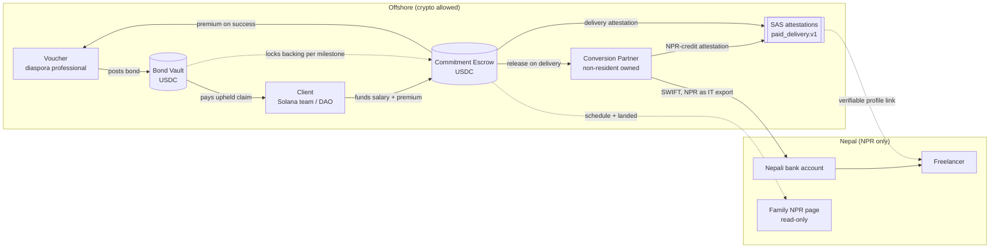
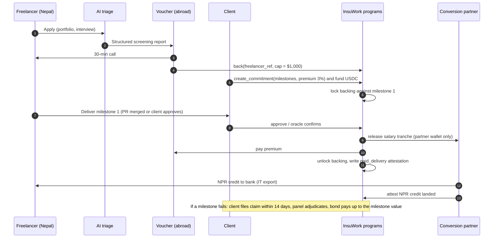

# InsuWork — Bonded Trust for Nepali Talent

> **InsuWork** is the product name; check it against trademarks and app stores before launch.

| | |
|---|---|
| **Document** | IDEA.md, the core definition of the project. All other docs, code and pitches derive from it. |
| **Version** | 0.1 (draft) |
| **Date** | 2026-10-09 |
| **Target** | Colosseum Solana fall hackathon (ends 2026-11-02), Superteam Nepal track: *"What if Nepal's best talents didn't have to leave"* |
| **Status** | Pre-validation. The kill tests in §14 have not run yet. |
| **Not legal advice** | Every legal statement in this document comes from secondary sources and must be confirmed by a Nepali lawyer before launch (§11). |

---

## 0. TL;DR

**Problem.** Foreign clients write "not for Nepal / South Asia" on freelance jobs. They don't doubt that Nepalis *can* do the work. They can't tell *who* will actually do it (rented accounts, proxies, stolen portfolios), and they have no recourse if the work never arrives. A fresh Nepali graduate with no track record can't break that loop. Many families then pay Rs 15–40 lakh for a study-abroad visa instead.

**Insight.** Trust is backed by **collateral**, not credentials. A skill badge costs nothing to fake. Money someone stands to lose does.

**Solution.** InsuWork lets **diaspora Nepali professionals put up a USDC bond (a deposit at risk) behind a specific freelancer back home**. The bond sits in a Solana program and pays the client if a delivery is not made. If the work is delivered, the voucher earns a premium that the client pays. Every escrow release that succeeds becomes an on-chain **proof of paid delivery**. The freelancer builds a record that is hard to fake and that they carry with them, starting with their first contract. **The freelancer and their family never touch crypto.** A non-resident partner converts everything offshore and pays it into a Nepali bank account in NPR.

**Expected change.** A final-year CS student whose family is about to pay a consultancy deposit gets a bonded, pre-funded first contract that their parents can see. The bet is that some families will **defer the deposit**. We measure this with a lottery and a control group, not with testimonials.

---

## 1. Problem space

### 1.1 The symptom
Global freelance marketplaces (Upwork, Fiverr) let clients restrict jobs by country ([Upwork support](https://support.upwork.com/hc/en-us/articles/40368273408915-Can-I-post-a-job-for-a-particular-country)). Many clients exclude South Asia outright, either through that filter or in the job text ("not for India/Pakistan/Nepal"). The quality of an individual Nepali freelancer doesn't matter: they are filtered out before anyone looks at them.

### 1.2 The real root causes (what our research found)

| # | Root cause | Evidence | Does a skill test fix it? |
|---|---|---|---|
| R1 | **Identity and proxy fraud.** The person hired is not the person working. | Upwork accounts are openly rented for **$200–350/month** (r/Upwork, r/Jobs4Crypto, r/Scams). Upwork responds with mass re-verification and bans ([golance](https://golance.com/de/blogs/upwork-account-suspended-what-to-do-next)). | ❌ No. A test only shows that *someone* passed it. |
| R2 | **No recourse.** If delivery fails, the client loses money and time with no remedy across borders. | Clients pre-filter regions to avoid that risk ([Medium](https://medium.com/the-everyday-freelancer/hard-truth-freelancers-from-third-world-countries-get-the-short-end-of-the-stick-45790f6d5344)). | ❌ No. |
| R3 | **Low-bid spam.** Floods of $2–4/hr proposals make a whole region look low quality. | [Upwork community thread on geo-discrimination](https://community.upwork.com/t5/Freelancers/Geo-location-discrimination-for-gigs-which-do-not-require-exact/m-p/961572), [Medium](https://medium.com/the-everyday-freelancer/hard-truth-freelancers-from-third-world-countries-get-the-short-end-of-the-stick-45790f6d5344). | ❌ No. |
| R4 | **Broken payment rails.** PayPal can't pay out in Nepal, Stripe is unavailable, Payoneer takes 2–3%, and forced NPR conversion costs another 2–5%. | [commonlaw.com.np](https://commonlaw.com.np/publications/is-payoneer-legal-in-nepal), [amarnepal](https://amarnepal.com/guides/how-to-get-paid-as-a-freelancer-in-nepal). | ❌ No. |
| R5 | **Cold start.** A newcomer has no reviews, so no client hires them, so they never get reviews. | Built into how marketplaces work. Upwork rejects profiles in saturated categories. | ⚠️ Partly, but a badge is weak evidence. |

**Conclusion.** The original idea, "an AI agent tests skills and issues a credential on Solana", targets the wrong cause. Skill was never the main thing in doubt. **Accountability and identity are.** (Validation run 2026-10-08, §15.)

### 1.3 Why it matters: brain drain
- **112,968** study-abroad No Objection Certificates (NOCs, the permit Nepali students need to study abroad) were issued in FY2023/24, and more than 600,000 over a decade ([Onlinekhabar](https://english.onlinekhabar.com/over-600000-students-obtained-noc-in-a-decade.html), [ICEF](https://monitor.icef.com/?p=34982)). Japan, Australia, Canada, the UK and the US are the top destinations.
- **839,266** labour permits were issued in FY2024/25. Remittance was about **26.9% of GDP** ([B360](https://www.b360nepal.com/detail/26185/remittance-inflows-rise-192-pc-to-over-rs-1723bn-in-fy-202425)).
- Youth unemployment (age 15–24) is **22.7%** (NLSS-IV 2022/23).
- Meanwhile Nepal's IT-service exports are **approaching $1B** ([Kathmandu Post, Feb 2026](https://kathmandupost.com/national/2026/02/25/nepal-s-it-exports-near-1-billion-can-the-momentum-be-sustained)). The demand exists, but the bridge into it is narrow.
- **The real decision point.** A family decides whether to pay a **Rs 15–40 lakh** consultancy or NOC deposit. The parents make this call, not the student. A credible local income *before* that payment is the only lever that acts in time. A refund or a prize that arrives afterwards does not.

### 1.4 Problem statement
> A skilled young Nepali freelancer cannot give a foreign client a credible, enforceable guarantee that **they personally** will deliver. Without that guarantee they can't get a first paid contract. Without a paid record their family sees no viable local income, so the family funds an exit.

### 1.5 Out of scope
- **Skill assessment as the product.** The market is commoditised (Upwork certifications, Braintrust AIR, Toptal), easy to cheat with AI, and has zero Colosseum winners (§10).
- **Building another marketplace.** Upwork, Yaha Chha, OnlineKaam and Freelanced Nepal already exist. InsuWork is a **trust layer that sits beside marketplaces**, not a replacement for them.
- **Unskilled labour migration** (most of the 839k permits). Our cohort is small and skilled. We say so openly (§8.4).

---

## 2. Core thesis

1. **Collateral beats credentials.** Economics research on *social collateral* shows that network ties stand in for collateral and reduce information gaps in lending and job referrals (Karlan, Mobius, Rosenblat & Szeidl, [*Trust and Social Collateral*, QJE 2009](https://www.povertyactionlab.org/sites/default/files/research-paper/19%20-%20Karlan%20et%20al.%20-%202009%20-%20QJE%20-%20TRUST%20AND%20SOCIAL%20COLLATERAL.pdf); [NBER w13126](https://www.nber.org/papers/w13126)). We make that tie **explicit, priced and enforceable**.
2. **Reputation must be earned through work, not issued.** a16z's reputation framework argues that reputation only signals anything if it is non-transferable and earned through activity. Our only reputation primitive is **a paid delivery that a real client funded and released**.
3. **The diaspora is the missing trust bridge.** Nepali engineers abroad have credibility with foreign clients, ties to people back home, and spare USDC or dollars. Today their only way to help is "come abroad too". InsuWork gives them a way to **profit when talent stays home**, which flips the usual diaspora incentive (see the council rule in §15: no payers who profit when people emigrate).
4. **Keep the crypto where it's legal.** The chain does the work that requires a chain: collateral that can be slashed, cross-border escrow among parties on three continents with no shared bank, and an auditable record of where funds came from. Nepal residents only ever see NPR (§11).

---

## 3. The solution

### 3.1 Three core building blocks

**A. Bonded Introduction (the vouching bond)**
- A **voucher** is a non-resident professional, ideally a diaspora alumnus of the freelancer's college. They deposit USDC into a personal, segregated **Bond Vault** on Solana.
- The voucher **backs** a specific freelancer up to an exposure cap. The cap is the most a client can claim from this bond for this freelancer. In v1, total exposure across all backings must be ≤ the bond (no leverage).
- When a client hires a backed freelancer, part of the backing is **locked against that contract's milestones**.
- If a milestone fails and a claim is upheld (§5.4), the client is paid from the bond, capped at that milestone's value.
- If milestones succeed, the voucher earns a **bond premium**. The **client pays it** on top of the contract price, because the client is the one being protected. The freelancer's pay is never reduced.

**B. Paid Delivery Record (proof of paid delivery)**
- Every successful milestone release writes a **Solana Attestation Service (SAS)** attestation ([SAS](https://solana.com/news/solana-attestation-service)) under the schema `insuwork.paid_delivery.v1`. It records the client, the amount band, the date, a hash of the milestone spec and the backing voucher. It also records whether the partner confirmed the NPR credit in Nepal.
- The subject is a **pseudonymous freelancer reference**, not a wallet the freelancer must hold (§11). The freelancer gets a public, verifiable profile link that works anywhere: an Upwork profile, a CV, LinkedIn.
- Only **successes** are written on-chain. Failures show up as losses on the *voucher's* bond record, not as a permanent public mark on a young person's name (§5.5).

**C. Compliant payout leg (USDC in, NPR out)**
- Every release can only go to the wallet of a **licensed offshore conversion partner owned by a non-resident**. The program enforces this.
- The partner converts the USDC to fiat and pays the freelancer's Nepali bank account by SWIFT as **IT-service export income**. This follows the NepalRelief (Sept 2026) and Cross River Bank → SWIFT pattern.
- The partner then posts an attestation that the NPR credit landed. This confirmation completes the Paid Delivery Record.
- The family gets a **read-only NPR page**: the schedule, what has landed, and a monthly income statement formatted for a bank loan or the NRB $25k/yr freelancer FX facility.

### 3.2 Optional modules (only if they earn their place)

| Module | What it does | Status |
|---|---|---|
| **AI triage interview** (where the original idea survives) | An AI agent screens applicants and writes a structured report **for vouchers**, so a busy engineer in Seattle can decide in 10 minutes whether to take a 30-minute call. It is **advisory only. It never issues credentials and never moves money.** | v1, lightweight |
| **zkTLS history import** | A freelancer proves an existing Upwork or Fiverr record (Job Success Score, earnings) without Upwork's API, via [Reclaim Protocol](https://blog.reclaimprotocol.org/posts/what-is-reclaim-protocol). Vouchers use it as underwriting data. | v2. May breach Upwork's ToS (§12) |
| **Work-session attestation** | Periodic liveness and device checks during a contract show that the bonded person is the one working. It directly addresses R1 (account renting). | v2, opt-in. Consent and hashes only, under the Privacy Act 2075 |
| **AI milestone check** | Compares a deliverable against its spec and gives the client a recommendation. The client still signs the release. | v2, advisory |
| **GitHub merge oracle** | A merged PR on the agreed repo releases a code milestone automatically (taken from Stay Contract). | v1 for code tasks |

### 3.3 Not building (decided)
- ❌ A skill-test oracle that issues credentials. It's gameable, it targets the wrong root cause, and the cluster has no winners.
- ❌ A token, points or tradable reputation. Transferable reputation destroys the signal.
- ❌ A freelancer guild pool funded by Nepal residents. Pooling crypto is illegal, and a rupee pool needs an insurance or cooperative licence.
- ❌ Any flow where a Nepal resident holds, receives or is told to buy crypto.
- ❌ Clawbacks from freelancers. Vests are forgiveness-only, to avoid the bonded-labour reading (from the Stay Contract design).

---

## 4. How it fits with Stay Contract

InsuWork is the **trust layer**, and Stay Contract (council pick, 2026-10-02) is the **commitment and payment layer**. They share one escrow program.

| Layer | Stay Contract provides | InsuWork adds |
|---|---|---|
| Who pays | Solana teams lock 6 months of salary in USDC | — |
| Who is hired | Final-year CS students with an open IELTS/JLPT/consultancy file | **Why a client would risk hiring a fresher**: a voucher's bond |
| Release logic | Starter-task tranche, monthly tranches, month-12 retention vest | Bond lock per milestone, claims, voucher premium |
| Evidence | A source-of-funds log stamped on every release | **Paid Delivery Record**, which the freelancer carries anywhere |
| Payout | Offshore partner, NPR to the family page | Same |

The combined pitch:

> *"Sita is a final-year Pulchowk CS student. Her family is about to pay Rs 30 lakh for a Japan consultancy. A Pulchowk alumnus in Seattle bonds $1,000 behind her. A Solana team locks six months of her salary on-chain. Every month she delivers, her parents watch NPR land in her bank account, and she builds a delivery record no rented account can fake. She never touches crypto."*

---

## 5. How it works, end to end

### 5.1 Money and trust flows



### 5.2 Lifecycle of one bonded contract



### 5.3 Onboarding by role
- **Freelancer.** Apply → AI triage → voucher call → KYC with the conversion partner (identity and bank account; the partner holds the PII, not the chain) → profile goes live as "Backed by [voucher], cap $X". **No wallet and no crypto.**
- **Voucher.** Must be a non-resident. KYC with the partner → connect a wallet → deposit USDC into their Bond Vault → review triage reports → back freelancers, each with a cap → watch exposure, premiums and claims on a dashboard.
- **Client.** Connect a wallet or Squads multisig → browse backed freelancers or invite one → create a Commitment with milestones and premium → fund it → approve deliveries or let the oracle do it → file claims if needed.

### 5.4 Claims and disputes
- **Window.** A claim must be filed within **14 days** after a milestone's due date. After that, the backing auto-unlocks.
- **Evidence.** The spec hash committed at creation, the delivery artefacts and the message log. Hashes go on-chain and the files stay off-chain.
- **Adjudication (v1).** A named **three-person panel**: one senior engineer nominated by InsuWork, one nominated by the voucher, one nominated by the client. Decision by majority within 7 days. Each panelist stakes a small fee that they lose if they don't rule in time.
- **Adjudication (v2).** A decentralised jury in the style of Kleros, or the hybrid AI and smart-contract dispute-resolution model from the archive literature.
- **Outcomes.** *Upheld*: the bond pays the client, capped at the milestone value, and the escrowed salary for that milestone is refunded to the client. *Rejected*: the milestone releases normally. *Partial*: pro-rata.
- **Anti-collusion.** A client and a voucher with a declared relationship can't be counterparties to each other. Claim rates per client are public, so a serial claimer becomes visible.

### 5.5 Fair treatment of freelancers
- Nothing negative about a freelancer is written on-chain. A failed delivery costs the **voucher**, who may then withdraw backing. The market signal works without a permanent public stain.
- A freelancer can **revoke their profile link** at any time. The attestations persist, but the link from the pseudonymous reference to the person is held off-chain by the partner and can be removed.
- There are no clawbacks, no exit penalties and no bonded-labour clauses. Stay incentives are **forgiveness-only vests** (Stay Contract design).

---

## 6. Stakeholders

### 6.1 Primary participants

| Stakeholder | Who exactly | What they want | What they give | What they get | Main risk to them |
|---|---|---|---|---|---|
| **Freelancer** | Final-year and fresh CS/IT students at Pulchowk, KU and TU with an open IELTS/JLPT/consultancy file. Secondary: early-career Nepali freelancers locked out of Upwork. | A first paid contract and a record that proves they are real | Work, KYC through the partner, a voucher call | NPR income as legal IT export, a portable Paid Delivery Record, an income statement for banks | Overpromising. A first contract is not a career. |
| **Family** | Parents deciding on the deposit | Proof that a local option is real *before* they borrow | Nothing | A read-only NPR schedule and money landing | Treating a 6-month contract as permanent security |
| **Voucher** | Non-resident Nepali professionals (foreign citizens in v1), ideally alumni of the freelancer's college | A way to help home without telling people to leave, plus a return | USDC bond, judgement, a 30-minute call | Premium on successful milestones, a public record as a backer | Losing bond capital. Securities or insurance rules where they live. |
| **Client** | v1: Solana teams, DAOs and Superteam sponsors that already hold USDC and need junior builders. v2: any offshore client. | Cheap talent without the "who's really working, and what if they vanish" risk | Salary in escrow plus a ~3% premium | A guarantee backed by real collateral, verified delivery history, Squads-controlled escrow | Claims being slow or unfair |
| **Conversion partner** | A licensed money transmitter or bank partner outside Nepal, owned by a non-resident (NepalRelief / Cross River pattern) | Volume and compliant flows | KYC, conversion, SWIFT, NPR-credit attestations | Per-payout fee or FX spread | Nepal regulatory exposure, AML |
| **InsuWork (the operator)** | An offshore entity **owned by a non-resident** (the 1964 Act bars a Nepal-resident founder from owning it) | A sustainable take rate | Programs, triage, dashboards, panel coordination | Platform fee (§7) | Founder-structure legality (§11) |

### 6.2 Ecosystem and institutional stakeholders

| Stakeholder | Role | Relationship |
|---|---|---|
| **Superteam Nepal** | Track host and judge, likely a first payer (bounties, retainers), and a source of introductions to Solana teams | Partner. **Disclose that they may be both payer and judge.** |
| **Solana Foundation / grants** | Possible seed funding for the first cohort's starter tasks | Funder |
| **Universities** (Pulchowk, KU, TU) | Cohort access and alumni networks for voucher recruiting | Channel partner |
| **Nepali banks** | Receive IT-export SWIFT credits; accept the income statement for loans | Infrastructure. They need a clean purpose code and PAN. |
| **Nepal Rastra Bank (NRB)** | Regulator for FX and crypto; runs the fintech sandbox (from 14 May 2026) | We must stay compliant. A long-term goal is a sandbox or no-objection route. |
| **Insurance regulators** (Nepal Insurance Authority, plus the client's and voucher's jurisdictions) | Could treat bonds as insurance or surety | Counsel needed (§11) |
| **Arbitration panelists** | Senior engineers who rule on claims | Paid per case |
| **Local platforms** (Yaha Chha, OnlineKaam, Freelanced Nepal) | Already run KYC and domestic gig flow | Possible integration partners: their freelancers could get backed |
| **Upwork / Fiverr** | Where the original "not Nepal" problem shows up | Indirect. The profile link may be used there. Circumvention rules are a risk. |

### 6.3 Who may oppose us
- **Education consultancies** earn from students leaving. A deferred deposit is lost revenue for them.
- **Hundi / informal FX operators** lose business when legal rails get better.
- **Account renters** see their business model undermined by session attestation (v2).

---

## 7. Economics and incentives

### 7.1 Parameters for v1 (tunable)

| Parameter | v1 value | Why |
|---|---|---|
| Minimum bond | $500 | Low enough for a diaspora engineer, high enough to sting if lost |
| Exposure per backing | ≤ 1 month of contract value | A claim covers the milestone at risk, not the whole contract |
| Leverage | 1:1 (total exposure ≤ bond) | No undercollateralised promises in v1 |
| Bond premium | 3% of milestone value, **paid by the client** | The client is the one protected. The freelancer's pay stays whole, and nothing has to flow out of Nepal. |
| Platform fee | 1% of released payroll, client-side | Comparable to or below Payoneer's 2–3% plus conversion |
| Partner fee | ~1% (FX spread or flat per payout) | Benchmarked against Payoneer and bank wire (to be measured, §9) |
| Claim window / ruling time | 14 days / 7 days | Fast enough for clients, fair to freelancers |

### 7.2 Worked example
- The voucher bonds **$1,000** and backs Sita with a $1,000 cap.
- The client hires Sita at **$1,000/month for 6 months**, funds $6,000 in escrow and pays a 3% premium ($30/month) plus a 1% platform fee ($10/month).
- If all 6 milestones succeed:
  - Sita receives the full **$6,000**, converted to NPR (about NPR 8 lakh in total, or about NPR 1.3 lakh a month), against a local fresher alternative of Rs 10–15k/month.
  - The voucher earns **$180**, an 18% return on capital over 6 months, at the risk of losing up to $1,000.
  - InsuWork earns **$60**.
- If milestone 4 fails and the claim is upheld, the client gets $1,000 from the bond plus a refund of milestone 4's escrow. The voucher has lost $1,000 − $90 in premiums earned = **−$910**.
- **Implication.** The voucher needs a delivery-failure rate well under ~15% per backing to come out ahead. That forces careful vouching, which is the point.

### 7.3 Incentive checks
- **Voucher and freelancer collude** (fake client, fake delivery, harvest premiums). The premium comes from the client's money, so a fake client is just paying themselves. There's no profit unless real third-party clients pay.
- **Client and voucher collude** (fake claim to drain the bond). The voucher's own money is in the bond, so this is self-defeating. Declared relationships are blocked.
- **Client files bad-faith claims** to get free work. Panel review, a public claim rate, and a small claim fee that is refunded if the claim is upheld.
- **Voucher backs anyone to farm premiums.** Losses wipe out premiums quickly (§7.2), and each voucher's claim history is public.

---

## 8. What we expect to happen (theory of change and metrics)

### 8.1 Causal chain
```
Voucher bond → client accepts a fresher → first paid contract → NPR visibly lands for the family
  → family defers or cancels the consultancy deposit → second contract via the Paid Delivery Record
  → 12-month retention vest → student is still in Nepal and earning at 12 and 24 months
```
Every arrow is a hypothesis. The weakest are **"client accepts a fresher"** (demand) and **"family defers the deposit"** (mechanism). The kill tests in §14 aim at both.

### 8.2 Measurement design (pre-registered)
- **Eligibility.** Final-year or recent CS/IT graduates from Pulchowk, KU or TU who have an **open** IELTS/JLPT booking or consultancy file, recorded at intake as a baseline.
- **Assignment.** Bonded contract slots are assigned by **lottery** among eligible applicants. Non-winners are the control group, and they get a waitlist place, not nothing.
- **Primary outcome.** NOC filed, or consultancy deposit paid, at **6 months**, winners vs control.
- **Secondary outcomes.** Deposit size not paid. Proof of withdrawal (a cancelled NOC or a refunded deposit). Second-contract rate. In-country status at **12 and 24 months**.
- **Honesty rules.** No self-reported intent as a primary outcome. Report null results publicly on the cohort dashboard.

### 8.3 Targets

| Horizon | Target (a hypothesis, not a promise) |
|---|---|
| **Hackathon (by 2026-11-02)** | ≥ 30 student survey responses with baseline NOC status. ≥ 5 vouchers committed and ≥ $2,500 bonded (devnet acceptable, mainnet preferred). ≥ 1 real client-funded starter task. 3–5 paid starter-task deliveries. ≥ 1 real NPR credit through the partner, or a clearly labelled mock. Lottery run for the first cohort. |
| **3 months** | 20 backed freelancers, 10 active contracts, claim rate < 10%, first second-contracts |
| **6 months** | 50 backed freelancers. **First primary-outcome read** (NOC/deposit, winners vs control). Partner flow productised. |
| **12–24 months** | Retention read. Decide whether to expand to non-crypto offshore clients and to Upwork-sourced contracts. |

### 8.4 Limits we state up front
- The numbers are small: **hundreds of people, not the 839k labour migrants**.
- A remote foreign contract can also **strengthen a skilled-visa CV**. The retention vest and the control group are how we test whether that effect dominates.
- The partner's NPR-credit attestation shows the **money landed in a Nepali account**. It does **not** prove the person is physically in Nepal.
- The pool of clients who hire freshers is **thin and unproven**. That is why the payer gate comes first.

---

## 9. System architecture

### 9.1 On-chain (Solana, Anchor)

| Program / account | Key fields | Notes |
|---|---|---|
| `BondVault` (one per voucher) | `voucher`, `usdc_vault`, `deposited`, `allocated`, `claims_paid`, `premiums_earned` | Segregated per voucher, **never pooled** (§11) |
| `Backing` | `bond`, `freelancer_ref`, `cap`, `locked`, `active` | `Σ cap ≤ deposited` in v1 |
| `Commitment` (shared with Stay Contract) | `client`, `freelancer_ref`, `partner`, `milestones[]`, `premium_bps`, `backing`, `vest` | Release destination **hard-coded to `partner`** |
| `Milestone` | `amount`, `due_ts`, `spec_hash`, `status`, `oracle` (`client_sig` \| `github_merge`) | |
| `Claim` | `commitment`, `milestone`, `evidence_hash`, `panel[3]`, `votes`, `status` | 14-day window, 7-day ruling |
| SAS schema `insuwork.paid_delivery.v1` | `freelancer_ref`, `client`, `amount_band`, `date`, `spec_hash`, `voucher`, `npr_credit_confirmed` | Issuers: the InsuWork program (delivery) and the partner (NPR credit) |

- `freelancer_ref = H(partner_kyc_id ‖ salt)`. **No personal data on-chain and no wallet needed by the freelancer.**
- Client treasuries can use **Squads** multisig. Network fees are paid by the client or sponsored.
- Every release carries `program_id + invoice_hash`, which builds a **source-of-funds log** (Stay Contract) to support the IT-export classification.

### 9.2 Off-chain
- **Web app**, with views for clients, vouchers, freelancers (public profile) and families (read-only NPR, in Nepali and English).
- **AI triage service**: structured interview → report for vouchers. Advisory, logged, and the applicant can appeal.
- **Oracles**: GitHub merge webhook → signed release instruction. Partner webhook → NPR-credit attestation.
- **Claims console** for panelists.
- **Partner integration**: KYC, conversion, SWIFT, purpose code, PAN and TDS paperwork for the freelancer.

### 9.3 Suggested stack
Anchor (Rust), the SAS SDK, Squads v4, and Next.js with a Solana wallet adapter on client and voucher pages only. A Postgres database holds off-chain evidence and triage reports. The hackathon build stays on **devnet**, with mainnet only for the real starter tasks where the partner is live.

### 9.4 Privacy and security
- PII stays with the partner, under its KYC regime and Nepal's **Individual Privacy Act 2075** (consent, purpose limitation).
- Liveness and biometrics (v2): only with explicit consent, and only hashes on-chain.
- The program is upgradeable through a multisig during the pilot, then frozen. External audit before mainnet scale.

---

## 10. Competitive landscape

### 10.1 Global trust and vetting incumbents

| Player | What they do | Why it doesn't solve our problem |
|---|---|---|
| **Upwork** Skills Certifications / Expert-Vetted | Tests, about a 49% pass rate ([GigRadar](https://gigradar.io/blog/upwork-skills-certifications)), plus a vetted tier | Stuck inside Upwork. Clients still filter by country. No financial recourse. |
| **Braintrust** | AI interviews (AIR), vetted network, blockchain-based matching | Selects for already-proven talent. No collateral behind individuals. |
| **Toptal** | Screens down to the "top 3%" by its own claim | Elite-only. A fresher can't get in. |
| **Payoneer / Wise** | Payment rails | Payments only. Nothing about trust. |

### 10.2 Nepali platforms

| Player | Model | Relation to InsuWork |
|---|---|---|
| [Yaha Chha](https://www.yahachha.com/) | Nepali marketplace with KYC on both sides | Domestic clients. A possible partner whose freelancers get backed. |
| [OnlineKaam](https://www.onlinekaam.com/) | Claims 1,000+ internally vetted freelancers | Its vetting doesn't carry abroad |
| [Freelanced Nepal](https://freelancednepal.com/) | Local marketplace, launched June 2026 | Early stage, domestic |
| MeroJob Freelance, Kullabs, TechSansar Marketplace | Local listings | Domestic |

None of them offers **cross-border recourse** or a **record that travels outside the platform**.

### 10.3 Solana builder corpus (Colosseum Copilot, as of 2026-10-08)
- **Skill-credential clones, with no prizes and no accelerator places**: `skillflex` (LLM evaluation → soulbound NFT, Breakout Apr 2025), `credchain`, `levelin`, `onchaincv`, `credence`, `skill-link`, `lockedin.ai`, `insto`, `deopp`. This is the strongest evidence for leaving the credential cluster.
- **Freelance escrow**: `gigentic`, `delance`, `ravdesk`, `trustless-work`, `isabipay-escrow`. Escrow is plumbing, not the product.
- **Nearest neighbours**: `bytebonds` (the worker issues bonds against their *own* future earnings, the reverse direction) and `kapture` (AI-verified proof of remote work releasing payroll).
- **No project found with third-party collateral that can be slashed behind an individual worker.** The caveat: absence in the corpus is not proof that nobody has built it.

### 10.4 Why InsuWork is different
1. **Collateral, not a credential.** Someone loses real money if the freelancer fails.
2. **The diaspora as underwriters**, with incentives that pay when talent stays.
3. **Legal by design for Nepal**: the crypto stays offshore and the freelancer gets NPR.
4. **A brain-drain metric with a control group**, not testimonials.

---

## 11. Legal and compliance design

**Ground rules** (secondary sources; see the 2026-10-08 legality pass):
- Crypto, stablecoins included, is **banned for Nepal residents**: holding, receiving, trading, *promoting*. The bases are the Foreign Exchange (Regulation) Act, the NRB Act and NRB notices. There were 50+ arrests in 2024–25 ([commonlaw](https://commonlaw.com.np/publications/cryptocurrency-law-in-nepal), [notarynepal](https://notarynepal.com/blog/punishment-for-cryptocurrency-in-nepal)).
- The **Act Restricting Investment Abroad (1964)** bars Nepali citizens from investing or owning abroad without permission ([Kathmandu Post](https://kathmandupost.com/national/2022/02/09/central-bank-sees-capital-flight-risk-in-illegal-investments-in-cryptocurrencies)).
- **Blockchain as a ledger is legal** ([lawsagar](https://lawsagar.com/2025/10/08/cryptocurrency-blockchain-laws-in-nepal/)). The **Electronic Transactions Act 2063** recognises key-pair digital signatures.
- IT-service export income through banks is legal. The conversion deadline is 30 days, and the individual freelancer FX facility goes up to $25k/yr.
- Watch: a **government crypto task force (Dec 2025)** and the **NRB regulatory sandbox (from 14 May 2026)**, which excludes stablecoins ([nepalnews](https://english.nepalnews.com/s/business/everything-you-need-to-know-about-nrbs-new-regulatory-sandbox/)).

**Component status**

| Component | Status | How we comply |
|---|---|---|
| Freelancer receives salary | 🟢 | NPR only, by SWIFT from the partner, classified as IT export |
| Freelancer's on-chain record | 🟢/🟡 | Pseudonymous ref, **no wallet, no tokens**. An optional linked key is a signature only, with fees sponsored. |
| Voucher bond | 🟡 | Non-resident vouchers (foreign citizens in v1). Segregated per-voucher vaults, no pooling. Structured as a **contractual performance deposit**, not insurance. Needs counsel in the voucher's and client's jurisdictions (insurance, surety, securities). |
| Bond premium | 🟡 | Paid by the client offshore. Nothing leaves Nepal. Needs securities and insurance review. |
| Operator entity | 🔴 → 🟢 | Must be owned by a **non-resident** co-founder or partner. A Nepal-resident founder can't own it. |
| Hackathon prize | 🔴 → 🟢 | Ask for fiat, or have it paid to the non-resident entity or teammate |
| Marketing in Nepal | 🔴 → 🟢 | Never tell Nepalis to buy or hold crypto. Market "a guaranteed contract paid in NPR". |
| Guild pool funded by residents | 🔴 | Not built |
| Liveness / biometrics (v2) | 🟢 | Explicit consent, purpose-limited, hashes only (Privacy Act 2075) |
| zkTLS import (v2) | 🟢 in Nepal / ⚠️ platform | The freelancer's own data with consent. Possible Upwork ToS breach. |

**Questions for counsel (blocking before mainnet)**
1. Is a freelancer reference with no wallet, or a wallet with zero balance used only to sign, "holding crypto" under the NRB notices?
2. Is a voucher's performance deposit insurance or surety under Insurance Act 2079 s.24/s.153 ([nepallaws](https://nepallaws.com/Laws/insurance-act-2079/chapter-20-miscellaneous/section-153-not-to-make-insurance-transactions-with-anyone-except-insurer/)), and in the main client and voucher jurisdictions (US, AU, JP)?
3. Does the 1964 Act cover Nepali **citizens living abroad** acting as vouchers?
4. Does partner-converted USDC qualify as IT-export income (purpose code, PAN, 5% TDS) under the NRB freelancer facility?
5. Could the voucher premium be a security (an investment contract) in the voucher's jurisdiction?

---

## 12. Risk register

| # | Risk | Likelihood | Impact | Mitigation | Owner |
|---|---|---|---|---|---|
| 1 | **No clients will hire freshers**, even with a bond | High | Fatal | Payer gate (§14). Start with Superteam bounties and starter tasks. | Founder |
| 2 | **Families don't defer deposits** (mechanism fails or runs backwards) | Medium | Fatal for the brain-drain claim | Pre-registered survey and lottery. Publish nulls. Fall back to the Retainer Rail framing. | Founder |
| 3 | No non-resident conversion partner | Medium | Fatal for legality | Gate by a hard date. A diaspora co-founder can own the offshore entity. | Founder |
| 4 | Bonds classified as insurance or securities | Medium | High | Counsel. Segregated, non-pooled, contractual deposits. Small pilot. | Counsel |
| 5 | Not enough vouchers | Medium | High | Recruit through alumni associations (Pulchowk, KU) and the NRNA. Start with people the vouchers already know. | Founder |
| 6 | Claims are slow or biased | Medium | Medium | Three-party panel, deadlines, public claim rates | Ops |
| 7 | Judges see it as "another credential/escrow app" | Medium | High for the hackathon | Lead with the bond and the named student, not the attestation. The demo opens on Sita. | Pitch |
| 8 | Upwork ToS (circumvention, data import) | Medium | Medium | Profile link only. No off-platform payment for Upwork-sourced jobs in v1. | Product |
| 9 | Smart-contract bug drains bonds | Low | High | Small caps, multisig upgrade authority, audit before scale | Eng |
| 10 | NRB policy change | Low–Med | ± | Watch the task force and the sandbox. Design for either direction. | Founder |

---

## 13. Roadmap

| Window | Goals | Exit criteria |
|---|---|---|
| **Week 0 (Oct 9–12): demand gate** | Message Superteam Nepal. DM 20 Solana teams for a $200–500 starter task. Survey 30 students. Contact 15 diaspora alumni about bonding $500. | **1 written client yes + 3 voucher yeses by Oct 12** |
| **Oct 12–15: partner gate** | Line up the non-resident conversion partner and get the legal read on IT-export classification | **Named partner by Oct 15** |
| **Week 2 (Oct 12–18): core programs** | `BondVault`, `Backing`, `Commitment`, `Milestone`, release to partner only, premium payout, SAS schema | Devnet end-to-end test passes |
| **Week 3 (Oct 19–25): claims and front ends** | `Claim` flow, client/voucher/family views, AI triage MVP, GitHub-merge oracle, fee benchmark vs Payoneer and bank wire | Live demo of the full lifecycle with one simulated claim |
| **Week 4 (Oct 26–Nov 1): real flows and story** | 3–5 real paid starter tasks, ≥ 1 real NPR credit, run the lottery, film the student and family, cohort dashboard | Submission by Nov 2 |
| **Months 1–6 after the hackathon** | Mainnet pilot of 20–50 freelancers, legal opinions, audit, first outcome read | Primary-outcome read at 6 months |
| **Months 6–24** | Non-crypto offshore clients, zkTLS import, session attestation, decentralised jury | Retention read at 12 and 24 months |

---

## 14. Kill tests and decision rules

| Test | Pass | Kill / pivot |
|---|---|---|
| **Client demand.** 20 Solana teams asked to fund a starter task for a bonded fresher | ≥ 1 written yes by Oct 12 (≥ 3 is strong) | 0 yes → pivot to **Retainer Rail** (existing contributors, payout rail only) |
| **Voucher supply.** 15 diaspora alumni asked to bond $500 | ≥ 3 yes | < 2 → the bond model fails. Fall back to Stay Contract without bonds. |
| **Mechanism.** 30 eligible students asked: "Would a pre-funded, bonded 6-month contract at about NPR 1 lakh/month, visible to your parents, make your family defer the deposit?" | ≥ 40% "yes" or "likely" | < 20% → the brain-drain claim is unsupported. Do not pitch it as brain drain. |
| **Willingness to pay for bonding.** Clients asked whether they'd pay a 3% premium for a bonded freelancer | ≥ 2 of 5 say yes | 0 → the voucher has no income; rethink who pays the premium |
| **Legality.** Partner and counsel on the IT-export route | Written yes | No → no real money flows. Demo on devnet only, clearly labelled. |

---

## 15. Decision log (how we got here)

| Date | Decision | Reason |
|---|---|---|
| 2026-09-30 → 10-01 | Crypto "paid manual work" gap-hunting stopped | 0 of 34 candidates survived across 69 agents. The space is picked over. |
| 2026-10-02 | Stay Contract chosen as the Nepal brain-drain entry (122-agent council) | The only idea with a real decision point, a cohort and a crypto-native payer |
| 2026-10-02 | Council rule: credentials, registries or escrow must never be **the product** | Zero Colosseum winners in those clusters |
| 2026-10-02 | Council rule: no payer who profits when people emigrate | Their incentive would push the mechanism the wrong way |
| 2026-10-08 | "AI oracle skill-test → Solana credential" rejected as the core | Wrong root cause (identity and recourse, not skill), 9+ clones, gameable by AI |
| 2026-10-08 | Diaspora vouching bonds chosen as the novel primitive | Grounded in social-collateral research. No on-chain equivalent found. |
| 2026-10-08 | Proof of *paid delivery* replaces proof of skill | Reputation must come from real work and money |
| 2026-10-08 | Legal design: Nepal side gets NPR only, all crypto offshore with non-residents | NRB ban, the 1964 Act, Insurance Act exposure |
| 2026-10-09 | Bond premium paid by the client, not taken from the freelancer | The client is the one protected. Avoids outward payments from Nepal. |
| 2026-10-09 | The AI agent is kept only as triage for vouchers | It adds real value (saves voucher time) without being a gameable oracle |

---

## 16. Open questions

1. **Name.** Check "InsuWork" for conflicts (trademarks, domains and app stores).
2. **Who is the non-resident co-founder or entity owner?**
3. **Bond premium level.** Is 3% enough to attract vouchers and low enough for clients? Test with both groups.
4. **Panel v1 membership.** Who are the first panelists, and how are they paid?
5. **Expansion order after the pilot.** Non-crypto offshore clients first, or Upwork-sourced contracts? The latter depends on the ToS review.
6. **Can a voucher also be the client** (a diaspora founder hiring through their own bond)? This needs anti-collusion rules.
7. **Should the 12-month retention vest be funded by the client, by grants, or by a share of the voucher premium?**

---

## 17. Glossary

| Term | Meaning |
|---|---|
| **Voucher** | A non-resident professional who posts a USDC bond behind a specific freelancer |
| **Bond / Backing** | The voucher's deposit, and the capped share of it assigned to one freelancer |
| **Bond premium** | A fee the client pays to the voucher for each successful milestone |
| **Paid Delivery Record** | SAS attestations of client-funded, released milestones |
| **Conversion partner** | A licensed, non-resident-owned entity that converts USDC to fiat and pays NPR into Nepal |
| **NOC** | No Objection Certificate, the permit Nepali students need to study abroad |
| **NRB** | Nepal Rastra Bank, the central bank and FX/crypto regulator |
| **SAS** | Solana Attestation Service, the standard for on-chain verifiable attestations |
| **zkTLS** | Proofs that a web session showed some data, made without the site's API (e.g. Reclaim) |
| **Squads** | Solana multisig used for client treasuries |
| **Lakh** | 100,000 (Rs 30 lakh = NPR 3,000,000, about $22k) |
| **IT export income** | Foreign income for IT services, legally received in NPR through banks |

---

## 18. Sources and internal research

**Internal**
- `council-transcript-20261002-nepal-braindrain.md` and `council-report-20261002-nepal-braindrain.html`: the Stay Contract pick, council rules, gates
- `nepal-braindrain-results.json`: Nepal statistics, the NepalRelief precedent, Superteam Nepal track
- Copilot validation (2026-10-08): builder corpus clones, archives on reputation and SAS
- Novel-mechanism scan and legality pass (2026-10-08)

**External**
- Social collateral: [Karlan et al., QJE 2009](https://www.povertyactionlab.org/sites/default/files/research-paper/19%20-%20Karlan%20et%20al.%20-%202009%20-%20QJE%20-%20TRUST%20AND%20SOCIAL%20COLLATERAL.pdf), [NBER w13126](https://www.nber.org/papers/w13126)
- Solana Attestation Service: [solana.com](https://solana.com/news/solana-attestation-service)
- Reclaim / zkTLS: [Reclaim blog](https://blog.reclaimprotocol.org/posts/what-is-reclaim-protocol)
- Marketplace bias and fraud: [Upwork support](https://support.upwork.com/hc/en-us/articles/40368273408915-Can-I-post-a-job-for-a-particular-country), [Upwork community](https://community.upwork.com/t5/Freelancers/Geo-location-discrimination-for-gigs-which-do-not-require-exact/m-p/961572), [Medium](https://medium.com/the-everyday-freelancer/hard-truth-freelancers-from-third-world-countries-get-the-short-end-of-the-stick-45790f6d5344), [golance](https://golance.com/de/blogs/upwork-account-suspended-what-to-do-next)
- Payments: [commonlaw.com.np](https://commonlaw.com.np/publications/is-payoneer-legal-in-nepal), [amarnepal](https://amarnepal.com/guides/how-to-get-paid-as-a-freelancer-in-nepal), [NRB forex easing](https://newbusinessage.com/article/nrb-eases-foreign-exchange-provisions-for-nepali-travellers-and-traders)
- Incumbents: [GigRadar on Upwork certifications](https://gigradar.io/blog/upwork-skills-certifications), [Terminal on Braintrust/Toptal](https://www.terminal.io/blog/5-braintrust-competitors-for-hiring-software-engineers-in-2025)
- Nepali platforms: [Yaha Chha](https://www.yahachha.com/), [OnlineKaam](https://www.onlinekaam.com/), [Freelanced Nepal](https://freelancednepal.com/)
- Nepal law: [commonlaw (crypto)](https://commonlaw.com.np/publications/cryptocurrency-law-in-nepal), [notarynepal](https://notarynepal.com/blog/punishment-for-cryptocurrency-in-nepal), [lawsagar](https://lawsagar.com/2025/10/08/cryptocurrency-blockchain-laws-in-nepal/), [Kathmandu Post](https://kathmandupost.com/national/2022/02/09/central-bank-sees-capital-flight-risk-in-illegal-investments-in-cryptocurrencies), [Insurance Act 2079](https://pradhanlaw.com/publications/insurance-act-2079-2022-ad), [Privacy Act 2075](https://pioneerlaw.com/individual-privacy-act-2018-2075), [NRB sandbox](https://english.nepalnews.com/s/business/everything-you-need-to-know-about-nrbs-new-regulatory-sandbox/)
- Brain-drain data: [Onlinekhabar NOCs](https://english.onlinekhabar.com/over-600000-students-obtained-noc-in-a-decade.html), [ICEF](https://monitor.icef.com/?p=34982), [B360 remittance](https://www.b360nepal.com/detail/26185/remittance-inflows-rise-192-pc-to-over-rs-1723bn-in-fy-202425), [Kathmandu Post IT exports](https://kathmandupost.com/national/2026/02/25/nepal-s-it-exports-near-1-billion-can-the-momentum-be-sustained)
